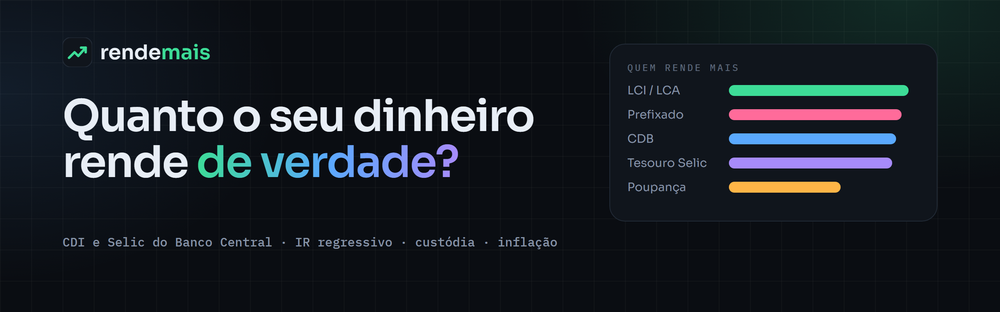
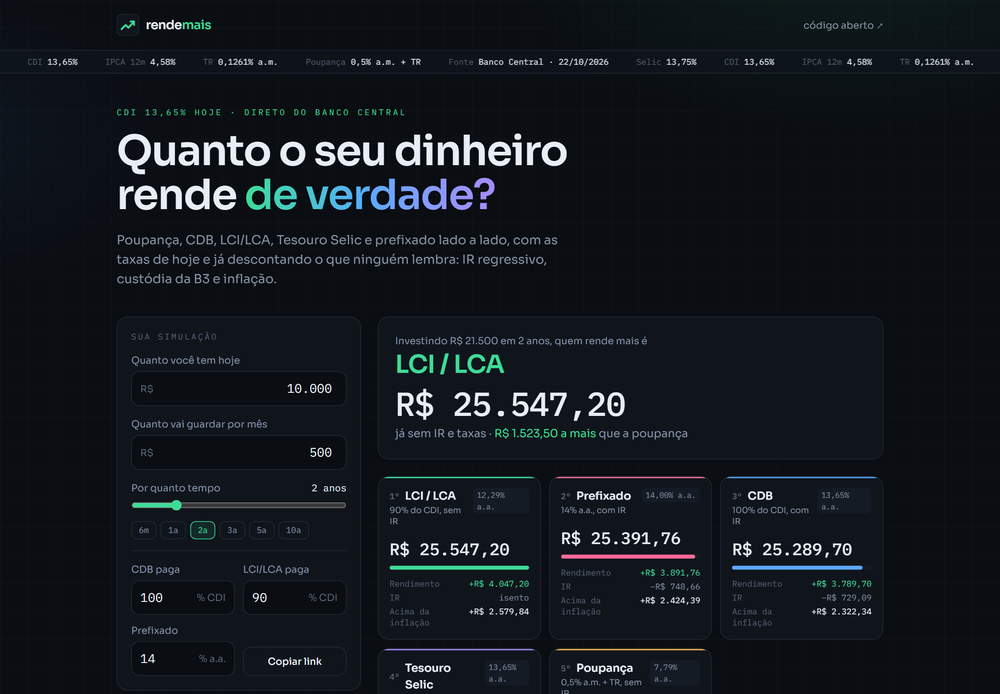
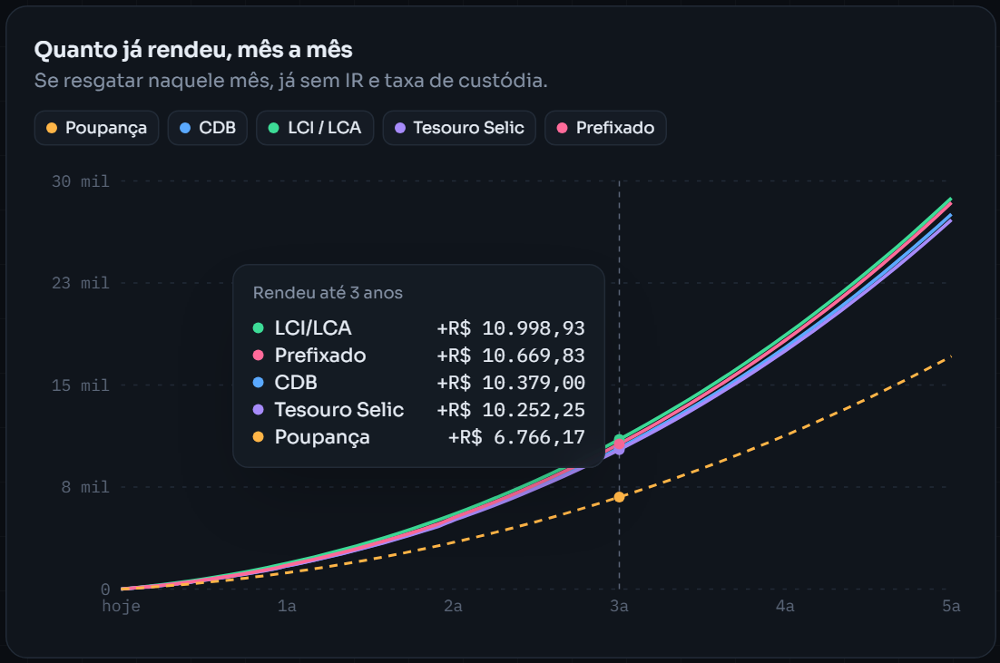

<div align="center">



<br />

[](https://github.com/Bleachless/rende-mais/actions/workflows/ci.yml)


**Poupança, CDB, LCI/LCA, Tesouro Selic ou prefixado: quanto rende de verdade?**
<br />
Com o CDI, a Selic, a TR e o IPCA de hoje, direto do Banco Central,
<br />
e já descontando o que ninguém lembra: **IR regressivo, custódia da B3 e inflação.**

</div>

---



## ✨ O que ele faz

- **Taxas de hoje, sozinho.** Selic, CDI, TR e IPCA vêm da API pública do Banco Central (SGS) e se atualizam de hora em hora.
- **Cinco investimentos lado a lado:** poupança, CDB (% do CDI), LCI/LCA (% do CDI), Tesouro Selic e prefixado.
- **Valor inicial e aportes mensais,** de 1 mês a 30 anos.
- **IR por aporte.** Cada aporte conta o próprio prazo na tabela regressiva: o dinheiro mais novo paga mais imposto.
- **Custódia da B3** no Tesouro Selic, só sobre o que passa de R$ 10 mil.
- **Ganho acima da inflação,** com os aportes corrigidos pelo IPCA.
- **CDB × LCI:** quanto o CDB precisa pagar para empatar com a LCI no seu prazo.
- **Link da simulação.** Os valores ficam no endereço: é só copiar e mandar.



## 🧠 As regras usadas

| | Como é calculado |
| --- | --- |
| Poupança | 0,5% a.m. + TR com a Selic acima de 8,5%; senão, 70% da Selic + TR. Sem IR |
| CDB | % do CDI, com IR regressivo |
| LCI/LCA | % do CDI, sem IR |
| Tesouro Selic | Selic efetiva, com IR e 0,20% a.a. de custódia acima de R$ 10 mil |
| Prefixado | taxa fixa ao ano, com IR |
| IR | 22,5% até 180 dias, 20% até 360, 17,5% até 720 e 15% depois |

É uma simulação educativa: as taxas de hoje ficam paradas pelo período todo, sem IOF (resgates com menos de 30 dias) e sem o limite do FGC. Não é recomendação de investimento.

## 🧪 Testes

```bash
npm test
```

10 testes cobrem a tabela do IR, as duas regras da poupança, o CDB com IR, a isenção da LCI, a custódia do Tesouro só acima de R$ 10 mil, o IR de cada aporte pela própria idade, o ganho real e a equivalência CDB × LCI.

## 🚀 Rodar localmente

```bash
git clone https://github.com/Bleachless/rende-mais.git
cd rende-mais
npm install
npm run dev
```

Abra http://localhost:3000. Se a API do Banco Central não responder, o app usa as últimas taxas conhecidas e avisa na tela.

## 🗂️ Por dentro

```
src/
├── app/page.tsx         # lê as taxas (em cache por hora) e monta a página
├── components/
│   ├── simulator.tsx    # formulário, vencedor, ranking e dicas
│   └── chart.tsx        # gráfico com Recharts
└── lib/
    ├── rates.ts         # séries do Banco Central (SGS)
    ├── calc.ts          # simulação mês a mês, IR por aporte e custódia
    └── calc.test.ts     # testes
```

---

<div align="center">

Feito por **[João Vaz](https://github.com/Bleachless)**, desenvolvedor full stack que trabalha no setor financeiro.
<br />
Veja também o **[Racha](https://github.com/Bleachless/racha)** 🧾 e o **[Cofrinho](https://github.com/Bleachless/cofrinho)** 🐷

</div>
